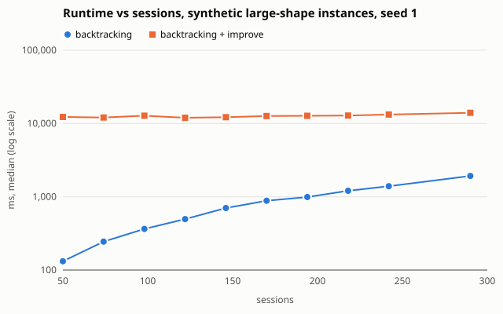
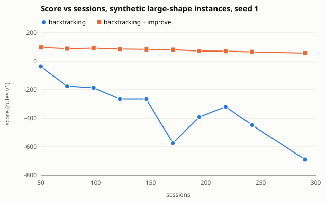
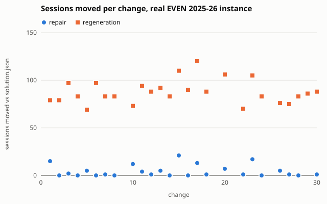

# Evaluation: synthetic presets and the real EVEN 2025-26 instance (S15b)

2026-10-21 · Rohan (with Claude Code) · Track C. Re-run 2026-11-01 for S15e, after S14u made both
D58 options the default and regenerated `solution.json` (−15.0 → 26.5). Every table below is from
that re-run; [S15e](#s15e-before--after) compares the headline numbers, and
[History](#history-the-numbers-before-s14u) keeps the earlier tables.

Reproduce (repo root, venv active, about 10 minutes):

```powershell
python -m bench.evaluate
```

It writes the five CSVs below and prints them as Markdown tables. Every number in this file
comes from those CSVs. Tests: `bench/tests/test_evaluate.py`.

| CSV (`bench/results/`) | Section | Before S14u (history) |
|---|---|---|
| `2026-11-01-eval-algorithms.csv` | 1, 2 | `2026-10-21-eval-algorithms.csv` |
| `2026-11-01-eval-real-vs-printed.csv` | 3 | `2026-10-21-eval-real-vs-printed.csv` |
| `2026-11-01-eval-rooms.csv` | 4 | `2026-10-21-eval-rooms.csv` |
| `2026-11-01-eval-free-rooms.csv` | 4 | `2026-10-21-eval-free-rooms.csv` |
| `2026-11-01-eval-repair.csv` | 5 | `2026-10-21-eval-repair.csv` |
| `2026-11-01-eval-size-sweep.csv` | 6 | `2026-10-24-eval-size-sweep.csv` |
| `2026-11-01-eval-repair-vs-regen.csv`, `2026-11-01-eval-repair-vs-regen-summary.csv` | 7 | `2026-10-24-eval-repair-vs-regen.csv`, `2026-10-24-eval-repair-vs-regen-summary.csv` |
| `2026-11-01-eval-lab-utilisation.csv`, `-lab-utilisation-generated.csv`, `-lab-utilisation-labs.csv` | 8 | `2026-10-25-eval-lab-utilisation.csv`, `-lab-utilisation-generated.csv`, `-lab-utilisation-labs.csv` |
| `2026-11-01-eval-edge-cases.csv`, `2026-11-01-eval-no-substitute.csv` | 9 | `2026-10-25-eval-edge-cases.csv`, `2026-10-25-eval-no-substitute.csv` |

Sections 6 and 7 were added on 2026-10-24 (S15c). Reproduce them with
`python -m bench.size_sweep` (about 6 minutes here) and `python -m bench.repair_vs_regen`
(about 30 minutes here, mostly 300 s timeouts; about 75 before S14u, with more timeouts). These
also write the charts in `docs/figures/`. Tests:
`bench/tests/test_s15c.py`. The full runs are marked `slow`, so they are deselected by default.

Sections 8–10 were added on 2026-10-25 (S15d). Reproduce them with
`python -m bench.lab_utilisation` (about 2 s here) and `python -m bench.edge_cases` (about
11 s here). Neither has a timed column. Tests: `bench/tests/test_s15d.py`; none is `slow`.

- **Machine:** AMD64 Family 25 Model 117 Stepping 2, AuthenticAMD, Python 3.12.10, Windows.
  Every `ms` figure is wall clock, machine-dependent, and the **median of 3 runs**. Every other
  figure is a pure function of the input. The script checks this: it stops if two runs
  disagree on anything except time.
- **Synthetic presets** (`small`, `medium`, `large`, `infeasible`, seeds 1–5) come from
  `solver.benchmarks.synthetic` (D19). They are not SPIT data. The only real data in them is
  the room list of `large`.
- **Real instance:** `data/instances/even-2025-26/edge_list.json`. The generated timetable is the
  committed `solution.json`, regenerated by S14u (26.5; `docs/real-solve-even-2025-26.md` § S14u).
  The printed timetable is `real_baseline.assignment.json`
  (`docs/real-baseline-even-2025-26.md`).
- **Algorithms:**
  - Welsh-Powell is `solver.colouring.welsh_powell`.
  - Backtracking is `solver.backtracking.backtrack_solve`, with a 300 s budget and its defaults
    since S14u: sub-rooms first within 5,000 nodes, then rooms by id in the time left (D58). In
    sections 1, 2 and 6 no run reached the budget or needed the second attempt (183 nodes at
    most).
  - Backtracking + improve is backtracking followed by `solver.improve.improve`, with
    200,000 moves and seed 0, also with sub-rooms first.
- **Hard violations:**
  - Backtracking is checked with `solver.validate.validate_solution`, which covers time and
    rooms.
  - Welsh-Powell assigns no rooms, so it is checked with `validate_slot_placements`, which
    covers time only. It is checked on the sessions it coloured.
- **Score:** `solver.scoring.score`, rules version 1. Score = 100 − the sum of the four
  penalties. Weights: S-GAP 2, S-B2B 1, S-LOAD16 1, FAC_LOAD_IMBALANCE 0.5.

## S15e: before → after

*Before* is the earlier `solution.json` (−15.0) with both D58 options off. *After* is S14u's
`solution.json` (26.5) with both on. The commands and seeds are the documented ones (synthetic
1–5, `improve()` seed 0, change draw seed 0), on the same machine. No seed was chosen by its
result.

| Measure | Section | Before S14u | After |
|---|---|---|---|
| Generated timetable, score | 3 | −15.0 | **26.5** |
| Against the printed timetable (21.5) | 3 | 36.5 below | **5.0 above** |
| Real instance, backtracking, score | 1 | −162.5 | −107.0 |
| Real instance, + improve (200,000 moves), score | 1 | −18.5 | 9.0 |
| Real instance, backtracking ms; + improve ms | 1, 2 | 187.6; 9,176.7 | 162.2; 8,891.6 |
| Synthetic + improve, score range, `medium` | 1 | 88.5 to 89.5 | 88.5 to 90.0 |
| Synthetic + improve, score range, `large` | 1 | 59.5 to 69.0 | 65.5 to 70.5 |
| Lab periods used, of 405 | 4 | 252 (62.2%) | 203 (50.1%) |
| Classroom periods used, of 180 | 4 | 83 (46.1%) | 83 (46.1%) |
| Free labs per slot, median; slots with none | 4 | 3; 5 | 6; 3 |
| Free classrooms per slot, median; slots with none | 4 | 2; 7 | 2; **10** |
| Six repair scenarios: repaired; slots moved | 5 | 4; 1 to 6 | 4; 0 to 2 |
| Size sweep, 50 → 290 sessions, backtracking ms | 6 | 157.9 → 2,921.2 | 131.9 → 1,925.4 |
| Size sweep, + improve, seconds | 6 | 13.3–17.0 | 12.0–14.0 |
| Size sweep, 50 → 290 sessions, + improve score | 6 | 96.0 → 59.0 | 96.0 → 57.0 |
| 30 changes: solved, repair; regeneration | 7 | 23; 21 | 25; 26 |
| 30 changes: timeouts, repair; regeneration | 7 | 6; 8 | 3; 2 |
| Changes solved both ways | 7 | 19 | 25 |
| **Moved, repair**, mean [95% CI] | 7 | 4.53 [0.98, 8.07] | **4.48 [1.93, 7.03]** |
| **Moved, regeneration**, mean [95% CI] | 7 | 85.68 [80.45, 90.92] | **87.76 [82.52, 93.00]** |
| **Score, repair**, mean [95% CI] | 7 | −23.11 [−28.37, −17.84] | **16.36 [10.06, 22.66]** |
| **Score, regeneration**, mean [95% CI] | 7 | −19.79 [−24.84, −14.74] | **10.60 [5.28, 15.92]** |
| Score, repair minus regeneration, mean [95% CI] | 7 | −3.32 [−10.10, 3.47] | +5.76 [1.42, 10.10] |
| Repair runtime, median ms; longest solved | 7 | 326.8; 55,414.7 | 233.2; 2,833.6 |
| Regeneration runtime, median ms | 7 | 9,279.7 | 8,607.2 |
| Sessions holding a whole split lab | 8 | 35 | 0 |
| Lab units holding more than 30 cells | 8 | 4 | 0 |
| Sessions with no free qualified substitute, of 156 | 9 | 30 | **37** |

**Unchanged, compared row by row with the earlier CSVs:** the printed timetable's rows (sections
3 and 4), every Welsh-Powell result except time (sections 1 and 6), the printed lab figures
(section 8) and all eight edge cases (section 9). Every timetable still has 0 hard violations.

**How to read the comparison:**

- **Section 7 is not change by change.** The draw depends on `solution.json`, so seed 0 now gives
  different changes, and the means cover 25 changes instead of 19. Only the summaries can be set
  side by side. They cannot say how much of a difference comes from the new defaults and how much
  from the new draw.
- **Section 5's "before" is older than S14b** (2026-10-21), so its method and runtime differ for
  more reasons than D58. `docs/repair-even-2025-26.md` § S14u gives the fair comparison.
- **The small runtime differences are not a finding.** They are single-machine wall clock, and
  `test_full_runs` measured the same sweep at 173.2 → 2,109.9 ms.
- **Not everything improved.** Using sub-rooms leaves more labs free, but the timetable now has 10
  slots with no free classroom instead of 7, and 37 sessions with no free substitute instead of 30.

**How this was run (2026-11-01):**

| Command | Seconds | Result |
|---|---|---|
| `python -m bench.evaluate`, first run | 707.9 | Timings not used (below) |
| `python -m bench.evaluate`, second run | 542.0 | The CSVs used here |
| `python -m bench.size_sweep` | 381.7 | |
| `python -m bench.repair_vs_regen` | 1,757.7 | 5 of the 60 runs took the full 300 s |
| `python -m bench.lab_utilisation` | 1.6 | |
| `python -m bench.edge_cases` | 10.9 | |
| `pytest bench/tests -m slow`: `test_full_runs` | 2,153.2 | Passed |
| `pytest bench/tests -m slow`: `test_main_writes_dated_csvs_all_scenarios` | 47.8 | Passed |

- **Two runs of `bench.evaluate`.** In the first, a contiguous block of rows (`small` seed 3 to
  `medium` seed 4) ran about 1.8 times slower than the rows around it, Welsh-Powell included:
  `medium` seeds 1–3 + improve took 22.7–23.1 s, against 12.5–12.7 s in the second run. The cause is not
  known. It was run once more, having decided beforehand to use that second run whatever it showed.
  Every column except time was identical in all five CSVs.
- **Repeatability.** `test_full_runs` is a separate complete run of the sweep and of the 30
  changes. Every column except time equals the CSVs here, including which runs timed out.

## 1. Algorithms

### Real instance (156 sessions, 1,568 edges)

| Algorithm | Outcome | Placed | Hard violations | Score | S-GAP | S-B2B | S-LOAD16 | FAC_LOAD_IMBALANCE | Nodes | Moves | ms |
|---|---|---|---|---|---|---|---|---|---|---|---|
| Welsh-Powell | 8 unplaced | 148 | 0 (time only, 148 coloured) | n/a | n/a | n/a | n/a | n/a | n/a | n/a | 10.4 |
| Backtracking | solved | 156 | 0 | −107.0 | 94.0 | 46.0 | 6.0 | 61.0 | 92 | n/a | 162.2 |
| Backtracking + improve | solved | 156 | 0 | 9.0 | 12.0 | 22.0 | 6.0 | 51.0 | 92 | 200,000 | 8,891.6 |

Welsh-Powell gives no score here because 8 sessions are uncoloured, and the score needs every
session. The committed `solution.json` used 1,000,000 moves and scores 26.5 (section 3).

### Synthetic presets, seed 1

| Preset | Algorithm | Outcome | Placed | Hard violations | Score | S-GAP | S-B2B | S-LOAD16 | FAC_LOAD_IMBALANCE | Nodes | ms |
|---|---|---|---|---|---|---|---|---|---|---|---|
| small (12) | Welsh-Powell | complete | 12 | 0 (time only) | 90.0 | 0.0 | 2.0 | 0.0 | 8.0 | n/a | 0.7 |
| small | Backtracking | solved | 12 | 0 | 65.5 | 24.0 | 3.0 | 0.0 | 7.5 | 11 | 7.9 |
| small | + improve | solved | 12 | 0 | 95.0 | 0.0 | 0.0 | 0.0 | 5.0 | 11 | 6,370.7 |
| medium (81) | Welsh-Powell | complete | 81 | 0 (time only) | −29.0 | 60.0 | 35.0 | 0.0 | 34.0 | n/a | 6.3 |
| medium | Backtracking | solved | 81 | 0 | −64.0 | 120.0 | 19.0 | 0.0 | 25.0 | 58 | 156.8 |
| medium | + improve | solved | 81 | 0 | 89.0 | 0.0 | 0.0 | 0.0 | 11.0 | 58 | 12,657.6 |
| large (242) | Welsh-Powell | complete | 242 | 0 (time only) | −262.5 | 190.0 | 80.0 | 0.0 | 92.5 | n/a | 18.5 |
| large | Backtracking | solved | 242 | 0 | −447.5 | 418.0 | 49.0 | 0.0 | 80.5 | 153 | 1,391.7 |
| large | + improve | solved | 242 | 0 | 65.5 | 0.0 | 0.0 | 0.0 | 34.5 | 153 | 13,134.6 |
| infeasible (46) | Welsh-Powell | 2 unplaced | 44 | 0 (time only, 44 coloured) | n/a | | | | | n/a | 5.8 |
| infeasible | Backtracking | infeasible (presolve: cohort_load) | 0 | n/a | n/a | | | | | 0 | 6.6 |
| infeasible | + improve | not run (nothing solved) | | | | | | | | | |

### Synthetic presets, score range over seeds 1–5

| Preset | Welsh-Powell | Backtracking | Backtracking + improve |
|---|---|---|---|
| small | 87.0 to 90.0 | 65.5 to 92.5 | 95.0 (all five) |
| medium | −58.0 to −1.5 | −125.0 to −55.0 | 88.5 to 90.0 |
| large | −262.5 to −158.0 | −654.0 to −377.0 | 65.5 to 70.5 |

Hard violations are 0 in all 45 rows of the three solvable presets. On every seed of
`infeasible`, Welsh-Powell leaves 2 sessions unplaced, and pre-solve refutes the instance
(`cohort_load`) before any search.

## 2. Runtime vs size

These are the bench presets, the same sizes as `docs/bench-2026-10-17.md`; bench has no other
size sweep. Each cell gives the minimum and maximum over seeds 1–5 of the per-seed median of 3
runs.

| Instance | Sessions | Edges | Backtracking nodes | Welsh-Powell ms | Backtracking ms | Backtracking + improve ms |
|---|---|---|---|---|---|---|
| small | 12 | 36 | 11 | 0.7 | 7.6–7.9 | 6,091.6–6,370.7 |
| medium | 81 | 883 | 58 | 5.9–6.3 | 148.8–156.8 | 12,546.2–12,677.3 |
| large | 242 | 2,936 | 153 | 17.5–18.5 | 1,363.5–1,429.9 | 12,896.0–13,305.9 |
| infeasible | 46 | 947 | 0 | 5.8 | 6.3–6.7 | n/a |
| real even-2025-26 | 156 | 1,568 | 92 | 10.4 | 162.2 | 8,891.6 |

The node count is the same on every seed of a preset. `improve()` always runs its full
200,000 moves, so most of the third column is local search.

## 3. Real generated vs printed timetable

| | Generated (`solution.json`) | Printed |
|---|---|---|
| Score | **26.5** | **21.5** |
| S-GAP (weight 2) | 1 raw, 2.0 | 2 raw, 4.0 |
| S-B2B (weight 1) | 20 raw, 20.0 | 23 raw, 23.0 |
| S-LOAD16 (weight 1) | 6 raw, 6.0 | 5 raw, 5.0 |
| FAC_LOAD_IMBALANCE (weight 0.5) | 91 raw, 45.5 | 93 raw, 46.5 |
| Hard violations, time only (`validate_slot_placements`) | **0** | **36**: FACULTY_CLASH 26, PINNED_BLOCK 10 |
| Hard violations, time and rooms (`validate_solution`) | **0** | not checkable (below) |
| Sessions with no room in the edge list | 0 | 58 |

The printed timetable cannot get the room check. 58 of its sessions are in rooms outside the
edge list's room set: 002 (24), 508 (27), 203 (2), lab 505 (4) and 403-A (1). These rooms are
excluded by D10, D28 and D29; the breakdown is in `docs/real-baseline-even-2025-26.md`. The 26
FACULTY_CLASH rows are combined lectures, which D40 schedules one per division. The 10
PINNED_BLOCK rows are TE practicals in slots held by frozen items (D24).

## 4. Room use, generated vs printed

### Used periods per room

The week has 45 teaching periods per room: 5 days × 9 periods (P0, P1, P3–P9). Rooms are shared
by SE and TE, and P4 and P5 are each one year's lunch (D6), so a room can be used in both.

A room counts as used in a period if a session or a pin holds the room, or holds one of its
sub-rooms. *Pinned* counts the periods held by pins: frozen items (D24, D35, D37). These are the
same in both timetables and are included in both *used* columns.

| Room | Kind | Sub-rooms | Pinned | Generated used | Printed used | Generated % | Printed % |
|---|---|---|---|---|---|---|---|
| 507 | lab | 0 | 1 | 23 | 1 | 51.1 | 2.2 |
| 509 | lab | 2 | 17 | 29 | 27 | 64.4 | 60.0 |
| 603 | lab | 3 | 16 | 31 | 31 | 68.9 | 68.9 |
| 604 | lab | 0 | 3 | 17 | 15 | 37.8 | 33.3 |
| 606 | lab | 2 | 6 | 19 | 28 | 42.2 | 62.2 |
| 607B | lab | 0 | 10 | 20 | 24 | 44.4 | 53.3 |
| 608 | lab | 0 | 10 | 18 | 20 | 40.0 | 44.4 |
| 702 | lab | 3 | 8 | 24 | 24 | 53.3 | 53.3 |
| 703 | lab | 2 | 14 | 22 | 24 | 48.9 | 53.3 |
| 601 | classroom | 0 | 3 | 24 | 5 | 53.3 | 11.1 |
| 605 | classroom | 0 | 8 | 20 | 11 | 44.4 | 24.4 |
| 609 | classroom | 0 | 12 | 23 | 14 | 51.1 | 31.1 |
| 701 | classroom | 0 | 0 | 16 | 0 | 35.6 | 0.0 |
| **9 labs** | | | 85 | **203 of 405 (50.1%)** | **194 of 405 (47.9%)** | | |
| **4 classrooms** | | | 23 | **83 of 180 (46.1%)** | **30 of 180 (16.7%)** | | |

The printed columns count only the 98 printed sessions whose room is in the edge list. The 58
sessions in rooms 002, 508, 203, 505 and 403-A appear in no row.

### Free rooms per slot

Each cell gives free classrooms / free labs. The rule is the one the free-room view uses
(`freeRoomsAt` in `frontend/src/adapters/rooms.ts`):

- A room used whole is not free.
- A lab with sub-rooms counts as free while at least one sub-room is free.
- A room without sub-rooms is free only when nothing uses it.

There are 4 classrooms and 9 labs.

Generated:

| | P0 | P1 | P3 | P4 | P5 | P6 | P7 | P8 | P9 |
|---|---|---|---|---|---|---|---|---|---|
| Mon | 3/8 | 3/7 | 1/5 | 3/5 | 3/8 | 2/3 | 3/4 | 4/4 | 0/5 |
| Tue | 3/3 | 2/0 | 1/4 | 3/5 | 2/5 | 2/5 | 4/7 | 4/7 | 0/9 |
| Wed | 2/0 | 0/0 | 0/6 | 2/7 | 0/8 | 0/9 | 4/9 | 3/6 | 1/7 |
| Thu | 3/6 | 0/4 | 1/4 | 2/7 | 3/2 | 3/3 | 4/8 | 4/8 | 0/9 |
| Fri | 0/7 | 4/2 | 0/1 | 1/6 | 4/8 | 2/2 | 3/2 | 4/9 | 4/9 |

Printed (rooms in the edge list only):

| | P0 | P1 | P3 | P4 | P5 | P6 | P7 | P8 | P9 |
|---|---|---|---|---|---|---|---|---|---|
| Mon | 3/8 | 3/7 | 2/5 | 4/5 | 4/9 | 2/2 | 4/1 | 4/8 | 4/9 |
| Tue | 4/5 | 3/5 | 1/1 | 3/1 | 4/5 | 3/5 | 4/7 | 4/7 | 4/9 |
| Wed | 2/1 | 2/1 | 2/4 | 4/5 | 4/8 | 2/9 | 4/9 | 4/9 | 4/9 |
| Thu | 3/6 | 3/6 | 3/3 | 4/4 | 4/1 | 4/2 | 4/7 | 4/7 | 4/9 |
| Fri | 2/6 | 4/6 | 1/4 | 3/4 | 4/8 | 4/1 | 3/1 | 4/9 | 4/9 |

| Over the 45 slots | Generated | Printed |
|---|---|---|
| Free classrooms: min / median / max | 0 / 2 / 4 | 1 / 4 / 4 |
| Slots with no free classroom | 10 | 0 |
| Free labs: min / median / max | 0 / 6 / 9 | 1 / 6 / 9 |
| Slots with no free lab | 3 | 0 |

## 5. Repair

These are the scenarios of `solver.benchmarks.real_repair`, run on the committed
`solution.json`. Each uses `solver.repair.repair` with seed 0 and the default budgets.
Runtimes are single runs, not medians. Moved, room-only and score are the same on every run.
`docs/repair-even-2025-26.md` explains each scenario.

| Scenario | Result | Moved (slot) | Room-only | Score before → after | Change | Rings (freed, outcome) | Runtime ms |
|---|---|---|---|---|---|---|---|
| Swapnali Kurhade unavailable all Tuesday | infeasible (presolve) | n/a | n/a | 26.5 → n/a | n/a | 0: 5 infeasible; 1: 59 infeasible; all: 156 infeasible | 32,735 |
| Lab 603 unavailable all Monday | repaired | 0 | 2 | 26.5 → 26.5 | 0.0 | 0: 3 solved | 100 |
| CE207 lecture dragged to a free slot (Wed 09.00, 601) | repaired | 1 | 0 | 26.5 → 16.0 | −10.5 | 0: 1 solved | 157 |
| CE207 lecture dragged onto SE-Comp A's frozen MDM-I lab (Mon 09.00, 605) | infeasible (mus) | n/a | n/a | 26.5 → n/a | n/a | none (pre-check) | 533 |
| Swapnali Kurhade unavailable Tuesday afternoon (P5–P9) | repaired | 1 | 0 | 26.5 → 15.5 | −11.0 | 0: 1 solved | 212 |
| CE207 lecture dragged onto an occupied slot (Mon 17.15, 605) | repaired | 2 | 1 | 26.5 → 24.5 | −2.0 | 0: 3 solved | 214 |

Moved, room-only, rings and scores are identical to `docs/repair-even-2025-26.md` § S14u. The
runtimes are lower than the ones recorded there, which came from a different machine. The
all-Tuesday scenario takes 32.7 s because it runs the full explanation (§ S14u: 48.7 s there).

## 6. Runtime and score vs size (S15c)

Source: `bench/results/2026-11-01-eval-size-sweep.csv`, written by `python -m bench.size_sweep`.

- **Instances.** These are synthetic (D19), not SPIT data. Each one is the `large` preset with
  only two parameters changed:
  - `divisions` is 2–9, which falls between the `small` (12 sessions) and `large` (242)
    presets; 10, which *is* `large`; and 12, which is above it.
  - `faculty` scales with divisions: 41 per 10 divisions, rounded, so 8, 12, 16, 21, 25, 29, 33,
    37, 41 and 49.

  Everything else is unchanged: 4 batches, 4 theory subjects × 3 hours, 3 lab blocks per
  division, 2 combined lectures, 2 pins per division, 4 unavailable slots per faculty member,
  and the 20 real rooms. All instances use seed 1.
- **Algorithms and runs.** The algorithms and checks are those of section 1. Every `ms` figure
  is the median of 3 runs on the machine above. The script stops if two runs disagree on
  anything except time.
- **Check.** The 10-division row matches section 1's `large` seed 1 on everything except time:
  153 nodes, backtracking −447.5, + improve 65.5.

| Divisions | Sessions | Edges | Backtracking nodes | Welsh-Powell ms | Backtracking ms | Backtracking + improve ms | Backtracking score | + improve score | + improve FAC_LOAD_IMBALANCE |
|---|---|---|---|---|---|---|---|---|---|
| 2 | 50 | 673 | 33 | 3.9 | 131.9 | 12,275.1 | −37.5 | 96.0 | 4.0 |
| 3 | 74 | 961 | 48 | 5.6 | 244.1 | 12,081.6 | −175.5 | 87.5 | 12.5 |
| 4 | 98 | 1,236 | 63 | 8.3 | 364.7 | 12,791.4 | −187.0 | 91.0 | 9.0 |
| 5 | 122 | 1,506 | 78 | 9.3 | 495.8 | 11,986.0 | −266.0 | 85.0 | 14.0 |
| 6 | 146 | 1,807 | 93 | 11.6 | 702.5 | 12,186.7 | −266.0 | 82.5 | 17.5 |
| 7 | 170 | 2,088 | 108 | 13.1 | 884.2 | 12,654.1 | −574.5 | 80.5 | 19.5 |
| 8 | 194 | 2,373 | 123 | 14.5 | 991.8 | 12,738.3 | −391.5 | 71.5 | 28.5 |
| 9 | 218 | 2,665 | 138 | 16.8 | 1,207.2 | 12,826.8 | −319.0 | 70.5 | 29.5 |
| 10 (`large`) | 242 | 2,936 | 153 | 18.0 | 1,394.9 | 13,262.8 | −447.5 | 65.5 | 34.5 |
| 12 | 290 | 3,507 | 183 | 22.1 | 1,925.4 | 13,991.3 | −687.5 | 57.0 | 41.0 |

The other outcomes were the same in every row:

- All 30 rows (10 sizes × 3 algorithms) have 0 hard violations.
- Welsh-Powell coloured every session.
- Backtracking solved every instance.
- After `improve()`, S-GAP and S-LOAD16 were 0 at every size. S-B2B was 0 except at 5 divisions
  (1.0) and 12 (2.0). So the + improve score is 100 − FAC_LOAD_IMBALANCE − S-B2B.





## 7. Repair vs regeneration on the real instance (S15c)

Source: `bench/results/2026-11-01-eval-repair-vs-regen.csv` (per change) and
`2026-11-01-eval-repair-vs-regen-summary.csv`, written by `python -m bench.repair_vs_regen`.

- **Changes.** 30 seeded random changes (seed 0) to the committed `solution.json`. The draw
  depends on that timetable, so the same seed now gives different changes from S15c's
  (see History). They alternate between two kinds, and the draw is with replacement:
  - Odd numbers: a faculty member who teaches is unavailable at 1–3 of the periods they teach
    in `solution.json`.
  - Even numbers: a top-level room is unavailable for a half-day in which `solution.json`
    uses it or one of its sub-rooms. Morning is P0, P1, P3 and P4 (09:00–13:15); afternoon is
    P5–P9 (13:15–18:15), from ROADMAP §5.

  So every change displaces at least one session. Two room changes were drawn twice: 14 and 28,
  and 18 and 30. Each pair gave the same results except for runtime.
- **Two ways.** Each change is handled two ways, both starting from `solution.json`:
  - **Repair** is `solver.repair.repair`, with seed 0, the default budgets and both D58 options
    on (its defaults since S14u), plus two settings for this benchmark. `time_limit_s=300` matches
    regeneration's budget: without it, the last ring (every session free) has no overall limit.
    One change ran for over 2 minutes with no answer while this was being set up. `mus_nodes=0`
    keeps the pre-solve or search diagnosis of an unsolvable change and skips the
    minimal-conflicting-set search; that search ran for over 20 minutes on change 9 of S15c's draw
    without finishing.
  - **Regeneration** is `solver.backtracking.backtrack_solve` on the changed edge list, with a
    300 s budget and its defaults (up to two attempts, D58), followed by
    `solver.improve.improve` with 200,000 moves and seed 0. (The committed `solution.json` used
    1,000,000 moves.) The CSV does not record which attempt solved a change.
- **Measures.**
  - *Moved* counts sessions whose start slot differs from `solution.json`.
  - *Room-only* counts sessions with the same slot but a different room.
  - *Score* is scored against the changed edge list.
  - Every solved result passed `validate_solution` against the changed edge list; the script
    stops otherwise.
  - Runtimes come from one run each, on the machine above.
  - No solved repair reached its 300 s cap (the longest took 2.8 s), so its moves and score do
    not depend on the machine.
- **Unsolved changes are kept.** A `timeout` means no answer within 300 s. It is not a proof of
  infeasibility (D33).

| # | Change | Repair | Moved | Room-only | Score | ms | Regeneration | Moved | Room-only | Score | ms |
|---|---|---|---|---|---|---|---|---|---|---|---|
| 1 | fac-kailas-devadkar unavailable Mon P4, Tue P1 | solved | 15 | 0 | 0.5 | 672.0 | solved | 79 | 41 | 18.5 | 8,711.7 |
| 2 | room-701 unavailable Mon morning | solved | 0 | 1 | 26.5 | 104.6 | solved | 79 | 43 | 16.0 | 8,480.7 |
| 3 | fac-reeta-koshy unavailable Tue P6, Wed P6 | solved | 2 | 0 | −8.5 | 359.3 | solved | 97 | 26 | 13.5 | 8,420.4 |
| 4 | room-606 unavailable Tue afternoon | solved | 0 | 4 | 26.5 | 111.2 | solved | 83 | 35 | 9.0 | 8,772.6 |
| 5 | fac-sudhir-dhage unavailable Wed P0 | solved | 5 | 0 | 21.0 | 488.8 | solved | 69 | 56 | 14.0 | 8,440.0 |
| 6 | room-604 unavailable Fri morning | solved | 0 | 3 | 26.5 | 114.6 | solved | 97 | 28 | 16.5 | 8,770.3 |
| 7 | fac-anant-nimkar unavailable Fri P0 | solved | 1 | 0 | 26.0 | 244.9 | solved | 83 | 39 | 15.0 | 8,286.7 |
| 8 | room-604 unavailable Wed afternoon | solved | 0 | 1 | 26.5 | 110.4 | solved | 83 | 32 | 9.0 | 8,760.5 |
| 9 | fac-sudeep-mali unavailable Mon P6, Thu P5, Fri P1 | infeasible (presolve) | n/a | n/a | n/a | 4,407.0 | infeasible (presolve: faculty_load) | n/a | n/a | n/a | 22.2 |
| 10 | room-509 unavailable Fri morning | solved | 12 | 3 | 20.0 | 1,602.0 | solved | 73 | 47 | 20.5 | 8,555.0 |
| 11 | fac-yogita-patil unavailable Thu P6 | solved | 4 | 0 | −1.0 | 221.1 | solved | 94 | 33 | 11.0 | 8,372.4 |
| 12 | room-605 unavailable Thu morning | solved | 1 | 2 | 15.0 | 222.9 | solved | 88 | 30 | 2.0 | 8,755.8 |
| 13 | fac-reeta-koshy unavailable Mon P7, Tue P5, Tue P6 | solved | 5 | 0 | −0.5 | 369.7 | solved | 92 | 33 | 1.5 | 8,729.8 |
| 14 | room-605 unavailable Wed morning | solved | 0 | 1 | 26.5 | 105.8 | solved | 83 | 33 | 9.0 | 8,877.3 |
| 15 | fac-sunil-ghane unavailable Tue P9, Thu P6, Thu P9 | solved | 21 | 0 | −37.5 | 1,010.6 | solved | 110 | 35 | −42.5 | 12,146.1 |
| 16 | room-608 unavailable Thu afternoon | solved | 0 | 3 | 26.5 | 108.0 | solved | 90 | 41 | 24.0 | 8,607.2 |
| 17 | fac-sanjyuktarani-jena unavailable Mon P6, Fri P1 | solved | 13 | 0 | 17.0 | 785.6 | solved | 120 | 22 | 10.0 | 8,398.0 |
| 18 | room-701 unavailable Thu morning | solved | 1 | 2 | 16.0 | 217.0 | solved | 88 | 27 | 2.0 | 8,723.1 |
| 19 | fac-abhijeet-salunke unavailable Fri P3 | timeout | n/a | n/a | n/a | 300,028.5 | timeout | n/a | n/a | n/a | 300,039.8 |
| 20 | room-607b unavailable Wed morning | solved | 7 | 1 | 21.0 | 1,763.8 | solved | 106 | 26 | 9.5 | 8,426.4 |
| 21 | fac-vaishnavee-rathod unavailable Mon P6, Thu P9, Fri P1 | timeout | n/a | n/a | n/a | 300,026.7 | timeout | n/a | n/a | n/a | 300,033.8 |
| 22 | room-609 unavailable Fri morning | solved | 1 | 0 | 26.0 | 237.5 | solved | 70 | 45 | 23.0 | 8,674.7 |
| 23 | fac-jostna-bhagat unavailable Fri P1 | solved | 17 | 4 | 15.5 | 2,833.6 | solved | 105 | 33 | 15.0 | 8,437.4 |
| 24 | room-509 unavailable Mon afternoon | solved | 0 | 6 | 26.5 | 121.1 | solved | 83 | 31 | 17.0 | 8,562.8 |
| 25 | fac-anuj-tawari unavailable Mon P8, Mon P9, Fri P4 | infeasible (presolve) | n/a | n/a | n/a | 5,560.9 | infeasible (presolve: hall_faculty) | n/a | n/a | n/a | 23.1 |
| 26 | room-701 unavailable Thu afternoon | solved | 5 | 0 | 25.0 | 531.3 | solved | 76 | 43 | 21.0 | 8,576.7 |
| 27 | fac-prasenjit-bhavathankar unavailable Mon P9 | solved | 1 | 0 | 25.5 | 233.2 | solved | 75 | 45 | 19.5 | 8,499.5 |
| 28 | room-605 unavailable Wed morning | solved | 0 | 1 | 26.5 | 99.5 | solved | 83 | 33 | 9.0 | 8,761.8 |
| 29 | fac-sanjyuktarani-jena unavailable Mon P7, Tue P5 | timeout | n/a | n/a | n/a | 300,229.7 | solved | 86 | 35 | 11.0 | 8,391.4 |
| 30 | room-701 unavailable Thu morning | solved | 1 | 2 | 16.0 | 221.5 | solved | 88 | 27 | 2.0 | 8,733.8 |

| | Repair | Regeneration |
|---|---|---|
| Solved (of 30) | 25 | 26 |
| Infeasible, proved by pre-solve | 2 (9, 25) | 2 (9, 25) |
| Timeout at 300 s | 3 (19, 21, 29) | 2 (19, 21) |
| Unsolved both ways | 4 (9, 19, 21, 25) | |
| Moved, mean [95% CI], over the 25 changes solved both ways | 4.48 [1.93, 7.03] | 87.76 [82.52, 93.00] |
| Score, mean [95% CI], same 25 | 16.36 [10.06, 22.66] | 10.60 [5.28, 15.92] |
| Runtime ms, mean [95% CI], all 30 changes | 30,771.43 [−3,327.39, 64,870.24] | 27,566.37 [−103.55, 55,236.28] |

The intervals are 95% Student-t intervals of the mean (Statistical Methods). The script
computes the critical value itself: Simpson's rule on the t density, then bisection. These
values match the printed t tables for 1, 4 and 29 degrees of freedom (tested).

The next figures were computed from the per-change CSV over the same 25 changes; the summary
CSV does not contain them:

- **Moved.** Regeneration moved 83.28 more sessions than repair on average (95% CI 78.64 to
  87.92). The smallest gap was 61. Repair moved nothing on 8 of the 25, re-rooming only, and those
  8 keep the score of 26.5.
- **Score.** Repair scored higher on 20 changes and lower on 5. Repair minus regeneration is
  +5.76 on average (95% CI 1.42 to 10.10). Repair starts from the 1,000,000-move timetable and
  regeneration gets 200,000 moves, as in S15c, so this favours repair.
- **Runtime.** Repair's median was 233.2 ms (range 99.5 to 2,833.6). Regeneration's median was
  8,607.2 ms (range 8,286.7 to 12,146.1). The means were 515.60 ms (95% CI 243.89 to 787.31) and
  8,739.23 ms (8,438.91 to 9,039.54).
- **Runtime over all 30 changes.** These means are dominated by the 5 runs that reached 300 s:
  repair has 3 and regeneration 2, so repair's mean is the higher here although it is far
  faster on the changes both solved. Both intervals reach below 0 because those runs skew them,
  so the medians above describe the times better.
- **Change 29.** Repair timed out at 300 s, and regeneration solved it in 8.4 s. Regeneration did
  not time out on any change repair solved.



Unsolved changes have no point in the chart: repair at 9, 19, 21, 25 and 29; regeneration at 9,
19, 21 and 25.

## 8. Lab utilisation, printed vs reproduced (S15d)

Source: `bench/results/2026-11-01-eval-lab-utilisation.csv`, written by
`python -m bench.lab_utilisation`. The printed half reads the printed files only, so S15e
reproduced it exactly.

- **Printed figures.** In `data/real/Lab CE_Time_Table-Even_sem_25-26.docx`, each of the 15
  lab tables comes after a line such as `Lab Utilization in %= 24/30= 80.00 %` (CONTEXT.md
  §3.6). `ingestion.lab_tt.parse_lab_timetable` keeps the line and its three numbers
  (`LabTable.printed`). Bench reads them from there and does not change ingestion. Every table
  prints the denominator 30. The file does not say what 30 counts; each table has 45 teaching
  cells (5 days × P0, P1, P3–P9).
- **Ours.** We count the table's occupied (day, period) cells again from the parsed cells
  (`LabEntry`). A cell counts if it is non-empty and not a break, P2 (coffee) never counts,
  and a cell named twice counts once. The count is over the printed denominator. In all 15
  tables our count equals ingestion's own `LabTable.occupied` (tested).
- **Match** means the same number of occupied cells. In every table the printed percentage
  agrees with its printed fraction, truncated to two decimals (20/30 is printed 66.66).
- **Mismatches are reported, not adjusted.** They are exactly the four tables that
  ingestion's anomaly report lists as `utilisation_mismatch` with "needs human" (tested).

| Table | Printed room | Printed | Printed % | Ours | Our % | Result | Difference |
|---|---|---|---|---|---|---|---|
| t0 | 607-B (607B) | 24/30 | 80.00 | 24/30 | 80.00 | match | 0 |
| t1 | 604 | 15/30 | 50.00 | 15/30 | 50.00 | match | 0 |
| t2 | 606-4 (606) | 24/30 | 80.00 | 24/30 | 80.00 | match | 0 |
| t3 | 606-5 (606) | 24/30 | 80.00 | 24/30 | 80.00 | match | 0 |
| t4 | 608 | 20/30 | 66.66 | 20/30 | 66.67 | match | 0 |
| t5 | 603-2 | 24/30 | 80.00 | 26/30 | 86.67 | **mismatch** | +2 |
| t6 | 603-3 | 22/30 | 73.33 | 20/30 | 66.67 | **mismatch** | −2 |
| t7 | 603-7 (603) | 12/30 | 40.00 | 14/30 | 46.67 | **mismatch** | +2 |
| t8 | 702-A | 22/30 | 73.33 | 20/30 | 66.67 | **mismatch** | −2 |
| t9 | 702-B | 20/30 | 66.66 | 20/30 | 66.67 | match | 0 |
| t10 | 702-C | 12/30 | 40.00 | 12/30 | 40.00 | match | 0 |
| t11 | 703-A | 19/30 | 63.33 | 19/30 | 63.33 | match | 0 |
| t12 | 703-B | 18/30 | 60.00 | 18/30 | 60.00 | match | 0 |
| t13 | 509 | 27/30 | 90.00 | 27/30 | 90.00 | match | 0 |
| t14 | 505 (not used for generation, D28) | 20/30 | 66.66 | 20/30 | 66.67 | match | 0 |

The room in brackets is the one the label normalises to (D27, D30). 11 of the 15 printed
figures are reproduced exactly. Two of the matches are the tables whose labels go beyond 606's
declared split (606-4, 606-5).

### The four mismatches

The CSV's `evidence` column lists, for every table, what the files show that could bear on a
difference:

- exam blocks in the grid;
- periods with no row in the table;
- class- or faculty-timetable cells that name the table's room at a period the table leaves
  empty.

Each cell in these tables is one 2-period block. Nothing below is a proven cause. The printed
figure stays as printed.

| Table | Ours − printed | What the files show |
|---|---|---|
| 603-2 | +2 | The grid holds the only exam block of the 15 tables (`DAA LAB EXAM ESE`, Wed P3–P4, D37). Without its 2 cells the grid holds 24, the printed figure. So the printed count fits a rule of leaving exams out. The file states no such rule, and no other table has an exam to test it on. |
| 603-3 | −2 | Nothing: no exam block, a row for every period, and no other timetable names 603-3 at a period the table leaves empty. 603-3 and 603-7 differ by opposite amounts: printed 22 + 12 = 34, ours 20 + 14 = 34. |
| 603-7 | +2 | Nothing explains it. The table holds 3 practical, 2 MDM and 2 BE (out-of-scope) cells. Leaving any one cell out would give 12, but no kind of cell singles one out: 604, 703-B and 509 have BE cells, and 703-A and 509 have MDM cells, and all of them match. The faculty timetable puts one more block in 603-7 that this grid lacks (Rupali Sawant, `MDM-I lab /A /603-7`, Mon P0–P1). That would widen the difference, not close it. |
| 702-A | −2 | The table has no 17.15–18.15 row (P9); the other 14 have one. The faculty timetable also puts two blocks in 702-A that the lab grid places elsewhere: Yogita Patil `ML /D /SRD /702-A`, Fri P0–P1 (in 702-B in the lab grid), and Soni Bhambar `MDM-III Lab (CC) /A /702-A`, Tue P7–P8 (in 703-A). Either block would make 22, both would make 24. Such cells are not specific to mismatches, though: 702-C and 703-A have them too, and both match. |

Over lab 603's three tables, the printed total is 58 and ours is 60 (`-lab-utilisation-labs.csv`).
The difference is the exam's 2 cells.

### The same measure for the generated timetable

Source: `2026-11-01-eval-lab-utilisation-generated.csv` (per unit) and
`2026-11-01-eval-lab-utilisation-labs.csv` (per lab), from the committed `solution.json`.

- **Units.** Each D8 lab of the edge list is one unit, or one unit per sub-room if it has
  sub-rooms. Some printed tables have no unit with the same label:
  - 606-4 and 606-5 go beyond 606's split; the edge list has 606-1 and 606-2.
  - 603-7 goes beyond 603's split; the edge list's third place is 603-1.
  - 509 is printed as one table; the edge list has two sub-rooms (D27).
  - 505 is not used (D28).
  - 507 has no printed table.
- **Held.** A teaching cell counts for a unit when a session or a pin holds that unit or the
  whole lab. A placement with `sub_room_id` null locks every sub-room
  (`solver.validate.validate_solution`). The pins are the frozen items (D24, D35, D37), the
  same ones the printed grid shows. *Of which whole room* counts the cells held through the
  whole lab.
- **Percentages** are over 30 (the printed denominator, for comparison) and over 45 (the
  teaching cells).

| Lab | Unit | Printed table | Held | Of which pinned | Of which whole room | % of 30 | % of 45 |
|---|---|---|---|---|---|---|---|
| 507 | 507 | none | 23 | 1 | 0 | 76.67 | 51.11 |
| 509 | 509-1 | none | 29 | 17 | 17 | 96.67 | 64.44 |
| 509 | 509-2 | none | 27 | 17 | 17 | 90.00 | 60.00 |
| 603 | 603-1 | none | 28 | 10 | 10 | 93.33 | 62.22 |
| 603 | 603-2 | 603-2 | 26 | 16 | 10 | 86.67 | 57.78 |
| 603 | 603-3 | 603-3 | 22 | 14 | 10 | 73.33 | 48.89 |
| 604 | 604 | 604 | 17 | 3 | 0 | 56.67 | 37.78 |
| 606 | 606-1 | none | 18 | 6 | 6 | 60.00 | 40.00 |
| 606 | 606-2 | none | 18 | 6 | 6 | 60.00 | 40.00 |
| 607B | 607B | 607-B | 20 | 10 | 0 | 66.67 | 44.44 |
| 608 | 608 | 608 | 18 | 10 | 0 | 60.00 | 40.00 |
| 702 | 702-A | 702-A | 14 | 6 | 0 | 46.67 | 31.11 |
| 702 | 702-B | 702-B | 20 | 4 | 0 | 66.67 | 44.44 |
| 702 | 702-C | 702-C | 16 | 0 | 0 | 53.33 | 35.56 |
| 703 | 703-A | 703-A | 19 | 9 | 3 | 63.33 | 42.22 |
| 703 | 703-B | 703-B | 16 | 10 | 3 | 53.33 | 35.56 |

| Lab | Printed tables | Printed occupied | Ours from the print | Generated units | Generated held | Sessions in the whole lab | Sessions in a sub-room |
|---|---|---|---|---|---|---|---|
| 507 | none | 0 | 0 | 507 | 23 | | |
| 509 | 509 | 27 | 27 | 509-1, 509-2 | 56 | 0 | 11 |
| 603 | 603-2, 603-3, 603-7 | 58 | 60 | 603-1, 603-2, 603-3 | 76 | 0 | 18 |
| 604 | 604 | 15 | 15 | 604 | 17 | | |
| 606 | 606-4, 606-5 | 48 | 48 | 606-1, 606-2 | 36 | 0 | 12 |
| 607B | 607-B | 24 | 24 | 607B | 20 | | |
| 608 | 608 | 20 | 20 | 608 | 18 | | |
| 702 | 702-A, 702-B, 702-C | 54 | 52 | 702-A, 702-B, 702-C | 50 | 0 | 20 |
| 703 | 703-A, 703-B | 37 | 37 | 703-A, 703-B | 35 | 0 | 8 |
| 505 | 505 (not used) | 20 | 20 | none | 0 | | |

- **Over 30, no unit exceeds 100% now.** The highest is 509-1, at 96.67%. Before S14u four did.
  The generated week may still use any of the 45 teaching cells. Whatever 30 counts in the printed
  file, the generated timetable is not bound by it. So *% of 30* can be compared with the printed
  figure as a count, not as a share of a fixed capacity.
- **Generated now holds fewer lab cells than the print in five labs:** 606 (36 against 48), 607B
  (20 against 24), 608 (18 against 20), 702 (50 against 52 by our count, 54 printed) and 703 (35
  against 37). It holds more in 603 (76 against 60 by our count, 58 printed), 604 (17 against 15)
  and 509 (56 against 27), though for 509 this sets two units against one printed table. It places
  no session in 505 (D28) and uses 507, which has no printed table.
  Section 4 counts the same rooms whole: 203 of 405 lab periods generated, 194 printed.
- **No session holds a whole split lab now.** Before S14u, 35 did. All 69 sessions in a split lab
  are in a sub-room, because the search and `improve()` try a split lab's sub-rooms first (D58,
  `solver/backtracking.py`, `_room_rank`). So the *of which whole room* cells are all pins, the
  frozen items that hold the whole lab. This closes the S15d report to Track A.

## 9. Edge cases (S15d)

Source: `bench/results/2026-11-01-eval-edge-cases.csv` and
`2026-11-01-eval-no-substitute.csv`, written by `python -m bench.edge_cases`. Tests: one per
case in `bench/tests/test_s15d.py`. S15e reproduced the edge-case table exactly; only the real
count below changed.
case in `bench/tests/test_s15d.py`.

- **Functions.** Every case goes through the public functions the backend calls:
  - `solver.graph.build_conflict_graph`
  - `solver.backtracking.backtrack_solve` and `BacktrackResult.to_solution_v2_dict`
  - `solver.mus.explain`
  - `solver.repair.substitute_candidates` and `solver.repair.repair`
  - `solver.validate.validate_solution`, run on every solved result
- **Instances.** The hand-built instances are test instances, not SPIT data. Their only real
  part is the D6 slot grid, read from the committed `edge_list.json`: 45 teaching cells. They
  have no pins, so neither year's lunch is blocked. `infeasible` and `small` are synthetic
  presets (D19), seed 1.
- **Infeasible results** are explained by `explain()`. The tests then apply the suggested
  relaxation with `solver.mus.apply_action` and solve again, outside `explain()`, to confirm
  it restores feasibility.

| Case | Instance | Outcome | Diagnosis | After `explain()` |
|---|---|---|---|---|
| Empty | no sessions | solved: 0 placed, 0 violations | | |
| Single session | one lecture | solved: 1 placed, 0 violations | | |
| No free substitute | two lectures at one slot, two teachers; the other qualified teacher teaches the second lecture | `substitute_candidates` returns none; the `substitute_faculty` repair is solved, displaces the lecture, and 0 violations against the changed edge list | | |
| Infeasible, found by pre-solve | synthetic `infeasible`, 46 sessions | infeasible, 0 search nodes | `presolve`: `presolve.cohort_load.d00`, MANUAL | `mus`: `cohort_clash.d00`, `cohort_clash.d00.d00-b0`, `pin.0`; RELAX_PINNED_BLOCK, verified `restored` |
| Infeasible, found by search | three lectures, one room, two periods in which all three teachers are available | infeasible after 3 nodes; pre-solve has no check for this | `search_exhaustion`, 1 session unplaced | `mus`: the three teachers' unavailability (15 groups); RELAX_FACULTY_AVAILABILITY, verified `restored` |
| A full division | one division, 45 one-period lectures, each by its own teacher | solved: 45 placed, 0 violations | | |
| Over-subscribed division | the same with 46 lectures | infeasible, 0 search nodes | `presolve`: `presolve.cohort_load.div` ("must be taught 46 periods … only 45 periods are free"), MANUAL | `mus`: `cohort_clash.div`; MANUAL (no single change was verified) |
| Timeout (D33) | synthetic `small`, 12 sessions, `node_limit=1` | `timeout`, not infeasible; `to_solution_v2_dict` raises ValueError ("no status for a search timeout (ROADMAP D33)"); without the limit, solved | | |

**Real data: sessions with no free qualified substitute.** For each of the 156 sessions of the
committed `solution.json`, `substitute_candidates` was run with the faculty that
`qualifications.json` lists for its subject (D53). That is the list the backend's substitutes
route reads. Every session has 3–5 other listed teachers, and **37 of 156 have none free at
their slot** (30 before S14u). For those 37, the documented next step (`substitute_candidates` docstring) is a
`substitute_faculty` repair, which moves the session, as in the hand-built case above. The real
repairs were not run here.

## 10. Phase 5 items and where they are answered

The Phase 5 checklist of `docs/CURRENT-PROGRESS.md`, item by item:

| Phase 5 item | Answered by |
|---|---|
| Property test: no timetable ever contains a conflict | `solver/tests/test_property_solved_is_valid.py` (Track A; seeded random instances, not Hypothesis) |
| Edge cases: empty, single session, no replacement, infeasible, over-subscribed division | Section 9; `2026-11-01-eval-edge-cases.csv`, `2026-11-01-eval-no-substitute.csv`; `bench/tests/test_s15d.py` |
| Benchmark: runtime vs instance size (plot) | Sections 2 and 6; `2026-11-01-eval-algorithms.csv`, `2026-11-01-eval-size-sweep.csv`; `docs/figures/runtime-vs-sessions.svg`, `docs/figures/score-vs-sessions.svg` |
| Benchmark: displaced sessions, repair vs regeneration (mean + CI) | Section 7; `2026-11-01-eval-repair-vs-regen.csv`, `2026-11-01-eval-repair-vs-regen-summary.csv`; `docs/figures/repair-vs-regen-moved.svg` |
| Benchmark: greedy-only vs greedy + backtracking quality | Section 1; `2026-11-01-eval-algorithms.csv` |
| Lab-utilisation percentages reproduced | Section 8; `2026-11-01-eval-lab-utilisation.csv`, `-lab-utilisation-generated.csv`, `-lab-utilisation-labs.csv`. 11 of 15 reproduced; 4 mismatches reported, not adjusted |
| Generated timetable compared against the department's real one | Sections 3 and 4; `2026-11-01-eval-real-vs-printed.csv`, `2026-11-01-eval-rooms.csv`, `2026-11-01-eval-free-rooms.csv`; `docs/real-baseline-even-2025-26.md` |
| API integration tests; frontend tests | `backend/tests/` (Track B: `test_api.py`, `test_auth.py`, `test_repair.py`, `test_substitution.py`, `test_fixes.py`); `frontend/src/**/*.test.ts(x)` (Vitest) |
| *(S)* Constraint-coverage table vs FET | Not done; no file answers it |
| *(C)* Weight sensitivity analysis | Not done; no file answers it |

## Findings

1. **Hard constraints.**
   - Every timetable from backtracking, with or without `improve()`, passed `validate_solution`
     with 0 violations: 15 synthetic instances and the real one.
   - Every complete Welsh-Powell colouring passed the time-only check.
2. **Completeness.**
   - Welsh-Powell coloured every session of the three solvable presets.
   - On the real instance it left 8 of 156 sessions uncoloured; backtracking solved it in 92
     nodes.
   - On `infeasible`, Welsh-Powell left 2 sessions unplaced, and pre-solve refuted the instance
     with 0 search nodes.
3. **Score, synthetic.**
   - Welsh-Powell scored higher than backtracking on 12 of 15 solvable instances: all medium
     and large seeds, and small seeds 1 and 4.
   - Backtracking + improve scored higher than both on all 15.
   - After `improve()`, S-GAP was 0 on all 15. FAC_LOAD_IMBALANCE was 5.0–34.5 and S-B2B
     0–3.0.
4. **Score, real.**
   - `improve()` raised the backtracking timetable from −107.0 to 9.0 with 200,000 moves.
     The committed 1,000,000-move timetable scores 26.5.
   - The generated timetable now scores 5.0 above the printed one (21.5). It is ahead on S-B2B by
     3.0, S-GAP by 2.0 and FAC_LOAD_IMBALANCE by 1.0, and behind on S-LOAD16 by 1.0.
   - The printed timetable breaks 36 hard constraints, time only. The generated one breaks 0,
     time and rooms.
5. **Runtime.**
   - Backtracking took 7.6–7.9 ms at 12 sessions, 148.8–156.8 ms at 81 and 1,363.5–1,429.9 ms
     at 242. On the real instance (156 sessions) it took 162.2 ms.
   - Backtracking + improve took 6.1–13.3 s across the presets, and 8.9 s on the real
     instance.
6. **Rooms.**
   - The generated timetable puts all 156 sessions in edge-list rooms. The printed one puts 98
     there.
   - So the generated timetable uses the 4 classrooms in 83 of 180 periods (printed: 30), and
     the 9 labs in 203 of 405 (printed: 194).
   - It leaves no classroom free in 10 slots and no lab free in 3. The printed timetable always
     leaves at least one of each, counted over these rooms only.
7. **Repair.**
   - 4 of the 6 scenarios were repaired, moving 0 to 2 sessions' slots, plus 0 to 2 room-only
     changes. Each took under 0.3 s here.
   - The other 2 were proved infeasible: the all-Tuesday absence by pre-solve (32.7 s with its
     explanation), and the drag onto a frozen lab by the drag pre-check (0.5 s).
   - The score fell in 3 of the repaired scenarios, by 2.0 to 11.0 points. Re-rooming lab 603's
     Monday kept 26.5.
8. **Size (S15c, synthetic, seed 1).**
   - From 50 to 290 sessions, backtracking's median time rose from 131.9 ms to 1,925.4 ms,
     and its nodes from 33 to 183, 15 more per added division.
   - Backtracking + improve took 12.0–14.0 s at every size; most of that is the fixed
     200,000-move local search.
   - Its score fell from 96.0 to 57.0. Its penalty at every size was FAC_LOAD_IMBALANCE, plus
     S-B2B of 1.0 at 5 divisions and 2.0 at 12.
   - Every timetable had 0 hard violations.
9. **Repair vs regeneration (S15c, real instance, 30 changes).**
   - Over the 25 changes both solved, repair moved 4.48 sessions on average (95% CI 1.93 to
     7.03) and regeneration 87.76 (82.52 to 93.00).
   - Mean scores were 16.36 (repair) and 10.60 (regeneration). Their intervals overlap, but the
     paired difference, +5.76 (1.42 to 10.10), excludes 0: repair scored higher on 20 of the 25.
     Repair starts from a timetable given 1,000,000 moves, regeneration gets 200,000.
   - Repair solved 25 changes and regeneration 26. 4 were unsolved both ways: 2 proved
     infeasible by pre-solve, 2 timeouts.
   - Repair timed out on 1 change that regeneration solved (29), and regeneration on none that
     repair solved.
10. **Lab utilisation (S15d).**
    - 11 of the 15 printed figures are reproduced exactly from the parsed lab timetable. Our
      count equals ingestion's in all 15 tables.
    - 603-2, 603-3, 603-7 and 702-A differ by one 2-period block each, and are reported, not
      adjusted. 603-2 fits leaving out its exam block. 702-A has no P9 row and two blocks the
      faculty timetable places there. 603-3 and 603-7 are not explained by the files, but their
      differences cancel.
    - In `solution.json`, no lab unit holds more than 30 cells now (four did before S14u). The
      printed denominator still does not bound the generated week.
    - No batch session holds a whole split lab now (35 did before S14u).
11. **Edge cases (S15d).**
    - Empty, single-session and 45-lecture-division instances solve with 0 violations.
    - Every infeasible case (pre-solve, search, over-subscribed division) returns a
      diagnosis, and `explain()` reduces each to a `mus`. Two relaxations were verified and
      re-checked; the over-subscribed division gets MANUAL.
    - A node budget gives `timeout`, which no contract can carry (D33).
    - With no free qualified substitute, `substitute_candidates` is empty and the
      `substitute_faculty` repair moves the session.
    - On the real instance, 37 of 156 sessions have no free qualified substitute (30 before S14u).

## Limits

- **Runtimes are medians of 3 runs on one machine**, with no confidence intervals (sections
  1, 2, 6). Section 7's runtimes are single runs; their interval is over changes, not repeated
  runs.
- **Size sweep (section 6).** It uses one seed and one instance shape, the `large` preset
  with divisions and faculty scaled. Other shapes and seeds were not swept.
- **Repair vs regeneration (section 7).**
  - It covers 30 changes of two kinds on one instance, drawn with replacement, so two are
    repeats. Drags and substitutions are not included.
  - Repair ran with `mus_nodes=0` and a 300 s cap, not its defaults, so unsolvable changes
    carry no minimal conflicting set here.
  - Repair's runtime is affected by these settings; regeneration's comes from a 200,000-move
    `improve()`.
  - Timeouts are unknowns: 2 changes were neither solved nor refuted by either method within
    300 s.
  - The summaries before and after S14u cover different changes, because the draw depends on
    `solution.json`. There is no paired measure of what the D58 defaults did to the same changes.
- **The comparison is not like for like:**
  - The printed timetable is checked on time only, and its room use counts only the 98
    sessions in edge-list rooms.
  - The printed timetable uses rooms outside the edge list (002, 508, 203, 505, 403-A). The
    generated one may not use them (D10, D28, D29).
- **Plots** are hand-written SVG (`bench/charts.py`); no plotting library is installed.
- **Lab utilisation (section 8).**
  - The mismatch evidence is what the parsed files show. It is not a cause; only the
    department can say how the printed figures were counted, or what 30 counts.
  - The generated measure counts a cell as held when the whole lab is held, so for split labs
    it is an upper bound on teaching in that sub-room.
- **Edge cases (section 9).**
  - Apart from the real substitute count, they are small hand-built or synthetic instances,
    one per case.
  - The real sessions without a free substitute were not repaired.

## History: the numbers before S14u

These tables are copied unchanged from the version of this file before S15e. They describe the earlier `solution.json` (−15.0) and the solver with both D58 options off. Their CSVs are still in `bench/results/` (see the table at the top). The earlier charts are in git at commit 718af25. Section 9's real count was 30 of 156 sessions with no free qualified substitute; the rest of section 9 and the printed half of section 8 did not change.

### Section 1, real instance

| Algorithm | Outcome | Placed | Hard violations | Score | S-GAP | S-B2B | S-LOAD16 | FAC_LOAD_IMBALANCE | Nodes | Moves | ms |
|---|---|---|---|---|---|---|---|---|---|---|---|
| Welsh-Powell | 8 unplaced | 148 | 0 (time only, 148 coloured) | n/a | n/a | n/a | n/a | n/a | n/a | n/a | 10.9 |
| Backtracking | solved | 156 | 0 | −162.5 | 158.0 | 42.0 | 6.0 | 56.5 | 92 | n/a | 187.6 |
| Backtracking + improve | solved | 156 | 0 | −18.5 | 30.0 | 32.0 | 6.0 | 50.5 | 92 | 200,000 | 9,176.7 |

### Section 1, synthetic presets, seed 1

| Preset | Algorithm | Outcome | Placed | Hard violations | Score | S-GAP | S-B2B | S-LOAD16 | FAC_LOAD_IMBALANCE | Nodes | ms |
|---|---|---|---|---|---|---|---|---|---|---|---|
| small (12) | Welsh-Powell | complete | 12 | 0 (time only) | 90.0 | 0.0 | 2.0 | 0.0 | 8.0 | n/a | 0.7 |
| small | Backtracking | solved | 12 | 0 | 65.5 | 24.0 | 3.0 | 0.0 | 7.5 | 11 | 8.7 |
| small | + improve | solved | 12 | 0 | 95.0 | 0.0 | 0.0 | 0.0 | 5.0 | 11 | 7,197.5 |
| medium (81) | Welsh-Powell | complete | 81 | 0 (time only) | −29.0 | 60.0 | 35.0 | 0.0 | 34.0 | n/a | 6.4 |
| medium | Backtracking | solved | 81 | 0 | −117.5 | 170.0 | 19.0 | 0.0 | 28.5 | 58 | 157.9 |
| medium | + improve | solved | 81 | 0 | 89.0 | 0.0 | 0.0 | 0.0 | 11.0 | 58 | 12,273.9 |
| large (242) | Welsh-Powell | complete | 242 | 0 (time only) | −262.5 | 190.0 | 80.0 | 0.0 | 92.5 | n/a | 18.3 |
| large | Backtracking | solved | 242 | 0 | −489.0 | 466.0 | 48.0 | 0.0 | 75.0 | 153 | 1,529.2 |
| large | + improve | solved | 242 | 0 | 69.0 | 0.0 | 0.0 | 0.0 | 31.0 | 153 | 14,396.5 |
| infeasible (46) | Welsh-Powell | 2 unplaced | 44 | 0 (time only, 44 coloured) | n/a | | | | | n/a | 5.9 |
| infeasible | Backtracking | infeasible (presolve: cohort_load) | 0 | n/a | n/a | | | | | 0 | 7.7 |
| infeasible | + improve | not run (nothing solved) | | | | | | | | | |

### Section 1, score range over seeds 1–5

| Preset | Welsh-Powell | Backtracking | Backtracking + improve |
|---|---|---|---|
| small | 87.0 to 90.0 | 65.5 to 92.5 | 95.0 (all five) |
| medium | −58.0 to −1.5 | −146.5 to −68.0 | 88.5 to 89.5 |
| large | −262.5 to −158.0 | −760.5 to −299.0 | 59.5 to 69.0 |

### Section 2

| Instance | Sessions | Edges | Backtracking nodes | Welsh-Powell ms | Backtracking ms | Backtracking + improve ms |
|---|---|---|---|---|---|---|
| small | 12 | 36 | 11 | 0.7 | 8.0–8.7 | 6,773.3–7,198.4 |
| medium | 81 | 883 | 58 | 6.2–6.4 | 154.0–160.6 | 12,273.9–12,690.5 |
| large | 242 | 2,936 | 153 | 17.5–23.8 | 1,509.4–1,785.2 | 14,378.4–15,823.4 |
| infeasible | 46 | 947 | 0 | 5.8–6.0 | 7.7–8.0 | n/a |
| real even-2025-26 | 156 | 1,568 | 92 | 10.9 | 187.6 | 9,176.7 |

### Section 3

| | Generated (`solution.json`) | Printed |
|---|---|---|
| Score | **−15.0** | **21.5** |
| S-GAP (weight 2) | 13 raw, 26.0 | 2 raw, 4.0 |
| S-B2B (weight 1) | 30 raw, 30.0 | 23 raw, 23.0 |
| S-LOAD16 (weight 1) | 6 raw, 6.0 | 5 raw, 5.0 |
| FAC_LOAD_IMBALANCE (weight 0.5) | 106 raw, 53.0 | 93 raw, 46.5 |
| Hard violations, time only (`validate_slot_placements`) | **0** | **36**: FACULTY_CLASH 26, PINNED_BLOCK 10 |
| Hard violations, time and rooms (`validate_solution`) | **0** | not checkable (below) |
| Sessions with no room in the edge list | 0 | 58 |

### Section 4, used periods per room

| Room | Kind | Sub-rooms | Pinned | Generated used | Printed used | Generated % | Printed % |
|---|---|---|---|---|---|---|---|
| 507 | lab | 0 | 1 | 27 | 1 | 60.0 | 2.2 |
| 509 | lab | 2 | 17 | 35 | 27 | 77.8 | 60.0 |
| 603 | lab | 3 | 16 | 34 | 31 | 75.6 | 68.9 |
| 604 | lab | 0 | 3 | 23 | 15 | 51.1 | 33.3 |
| 606 | lab | 2 | 6 | 24 | 28 | 53.3 | 62.2 |
| 607B | lab | 0 | 10 | 30 | 24 | 66.7 | 53.3 |
| 608 | lab | 0 | 10 | 28 | 20 | 62.2 | 44.4 |
| 702 | lab | 3 | 8 | 25 | 24 | 55.6 | 53.3 |
| 703 | lab | 2 | 14 | 26 | 24 | 57.8 | 53.3 |
| 601 | classroom | 0 | 3 | 21 | 5 | 46.7 | 11.1 |
| 605 | classroom | 0 | 8 | 21 | 11 | 46.7 | 24.4 |
| 609 | classroom | 0 | 12 | 21 | 14 | 46.7 | 31.1 |
| 701 | classroom | 0 | 0 | 20 | 0 | 44.4 | 0.0 |
| **9 labs** | | | 85 | **252 of 405 (62.2%)** | **194 of 405 (47.9%)** | | |
| **4 classrooms** | | | 23 | **83 of 180 (46.1%)** | **30 of 180 (16.7%)** | | |

### Section 4, free rooms per slot, generated

| | P0 | P1 | P3 | P4 | P5 | P6 | P7 | P8 | P9 |
|---|---|---|---|---|---|---|---|---|---|
| Mon | 3/8 | 3/7 | 0/2 | 2/2 | 3/0 | 1/0 | 1/4 | 4/1 | 0/6 |
| Tue | 3/0 | 2/0 | 1/4 | 3/4 | 2/1 | 2/1 | 4/7 | 4/7 | 0/9 |
| Wed | 1/2 | 1/2 | 0/4 | 2/5 | 2/1 | 2/2 | 4/9 | 3/1 | 1/2 |
| Thu | 3/6 | 0/4 | 1/3 | 2/6 | 3/0 | 2/1 | 4/8 | 4/8 | 2/9 |
| Fri | 0/2 | 4/1 | 0/2 | 1/3 | 4/8 | 2/2 | 3/2 | 4/9 | 4/9 |

### Section 4, over the 45 slots

| Over the 45 slots | Generated | Printed |
|---|---|---|
| Free classrooms: min / median / max | 0 / 2 / 4 | 1 / 4 / 4 |
| Slots with no free classroom | 7 | 0 |
| Free labs: min / median / max | 0 / 3 / 9 | 1 / 6 / 9 |
| Slots with no free lab | 5 | 0 |

### Section 5 (measured 2026-10-21, before S14b's pre-check and explanation)

| Scenario | Result | Moved (slot) | Room-only | Score before → after | Change | Rings (freed, outcome) | Runtime ms |
|---|---|---|---|---|---|---|---|
| Swapnali Kurhade unavailable all Tuesday | infeasible (presolve) | n/a | n/a | −15.0 → n/a | n/a | 0: 7 infeasible; 1: 85 infeasible; all: 156 infeasible | 183 |
| Lab 603 unavailable all Monday | repaired | 5 | 2 | −15.0 → −41.0 | −26.0 | 0: 7 infeasible; 1: 81 solved | 589 |
| CE207 lecture dragged to a free slot (Wed 09.00, 601) | repaired | 1 | 0 | −15.0 → −36.5 | −21.5 | 0: 1 solved | 229 |
| CE207 lecture dragged onto SE-Comp A's frozen MDM-I lab (Mon 09.00, 605) | infeasible (presolve) | n/a | n/a | −15.0 → n/a | n/a | 0: 1; 1: 38; 2: 146; all: 156, all infeasible | 220 |
| Swapnali Kurhade unavailable Tuesday afternoon (P5–P9) | repaired | 6 | 1 | −15.0 → −17.5 | −2.5 | 0: 1 infeasible; 1: 39 timeout (node budget); 2: 130 solved | 1,501 |
| CE207 lecture dragged onto an occupied slot (Mon 17.15, 605) | repaired | 4 | 1 | −15.0 → −27.0 | −12.0 | 0: 4 infeasible; 1: 80 solved | 599 |

### Section 6

| Divisions | Sessions | Edges | Backtracking nodes | Welsh-Powell ms | Backtracking ms | Backtracking + improve ms | Backtracking score | + improve score | + improve FAC_LOAD_IMBALANCE |
|---|---|---|---|---|---|---|---|---|---|
| 2 | 50 | 673 | 33 | 3.9 | 157.9 | 13,379.0 | −37.5 | 96.0 | 4.0 |
| 3 | 74 | 961 | 48 | 5.8 | 276.9 | 13,871.6 | −175.5 | 87.0 | 13.0 |
| 4 | 98 | 1,236 | 63 | 8.4 | 426.5 | 14,091.2 | −187.0 | 90.0 | 10.0 |
| 5 | 122 | 1,506 | 78 | 9.9 | 552.8 | 13,358.9 | −266.0 | 84.5 | 15.5 |
| 6 | 146 | 1,807 | 93 | 11.5 | 718.8 | 13,342.3 | −266.0 | 80.5 | 19.5 |
| 7 | 170 | 2,088 | 108 | 13.3 | 943.6 | 13,944.8 | −574.5 | 78.0 | 22.0 |
| 8 | 194 | 2,373 | 123 | 15.2 | 1,307.1 | 14,871.2 | −388.0 | 75.0 | 25.0 |
| 9 | 218 | 2,665 | 138 | 18.6 | 1,634.2 | 14,900.9 | −385.5 | 66.0 | 34.0 |
| 10 (`large`) | 242 | 2,936 | 153 | 19.1 | 1,677.8 | 14,579.3 | −489.0 | 69.0 | 31.0 |
| 12 | 290 | 3,507 | 183 | 23.9 | 2,921.2 | 16,956.8 | −561.5 | 59.0 | 41.0 |

### Section 7, per change (a different draw from today's: the changes depend on `solution.json`)

| # | Change | Repair | Moved | Room-only | Score | ms | Regeneration | Moved | Room-only | Score | ms |
|---|---|---|---|---|---|---|---|---|---|---|---|
| 1 | fac-kailas-devadkar unavailable Mon P4, Wed P0 | solved | 11 | 0 | −27.5 | 451.2 | solved | 70 | 40 | −19.5 | 8,831.8 |
| 2 | room-608 unavailable Fri morning | solved | 0 | 3 | −15.0 | 125.2 | timeout | n/a | n/a | n/a | 300,034.7 |
| 3 | fac-reeta-koshy unavailable Tue P5, Tue P6 | solved | 2 | 0 | −34.5 | 421.9 | solved | 86 | 26 | −27.0 | 9,133.7 |
| 4 | room-606 unavailable Mon afternoon | solved | 5 | 2 | −41.0 | 501.2 | solved | 86 | 30 | −14.5 | 9,255.4 |
| 5 | fac-sudhir-dhage unavailable Wed P3 | solved | 5 | 3 | −15.0 | 914.1 | timeout | n/a | n/a | n/a | 300,034.9 |
| 6 | room-604 unavailable Thu morning | solved | 0 | 2 | −15.0 | 112.2 | solved | 89 | 29 | −18.5 | 9,450.5 |
| 7 | fac-anant-nimkar unavailable Thu P4 | solved | 1 | 0 | −36.5 | 230.3 | solved | 63 | 44 | −9.5 | 8,983.9 |
| 8 | room-604 unavailable Mon morning | solved | 0 | 3 | −15.0 | 115.4 | solved | 93 | 30 | −4.0 | 9,226.1 |
| 9 | fac-sudeep-mali unavailable Mon P6, Mon P7, Thu P5 | infeasible (presolve) | n/a | n/a | n/a | 7,952.3 | infeasible (presolve: faculty_load) | n/a | n/a | n/a | 27.8 |
| 10 | room-509 unavailable Wed morning | solved | 0 | 1 | −15.0 | 131.0 | solved | 89 | 28 | −18.5 | 9,279.7 |
| 11 | fac-yogita-patil unavailable Fri P1 | solved | 16 | 7 | −50.0 | 5,423.1 | solved | 89 | 41 | −27.5 | 9,288.5 |
| 12 | room-605 unavailable Thu afternoon | solved | 0 | 2 | −15.0 | 111.9 | solved | 74 | 29 | −10.5 | 9,289.4 |
| 13 | fac-reeta-koshy unavailable Mon P8, Mon P9, Tue P5 | solved | 8 | 0 | −34.0 | 702.5 | solved | 85 | 35 | −28.5 | 9,047.8 |
| 14 | room-605 unavailable Tue afternoon | solved | 3 | 2 | −17.0 | 1,360.0 | solved | 74 | 33 | −11.0 | 9,134.0 |
| 15 | fac-sunil-ghane unavailable Wed P5, Thu P6, Thu P9 | timeout | n/a | n/a | n/a | 300,054.8 | timeout | n/a | n/a | n/a | 300,069.3 |
| 16 | room-607b unavailable Thu afternoon | solved | 0 | 4 | −15.0 | 121.3 | solved | 89 | 33 | −18.5 | 9,344.7 |
| 17 | fac-sanjyuktarani-jena unavailable Mon P5, Thu P5 | timeout | n/a | n/a | n/a | 300,287.1 | solved | 102 | 45 | −12.0 | 9,322.6 |
| 18 | room-609 unavailable Wed morning | solved | 0 | 1 | −15.0 | 107.0 | solved | 89 | 29 | −18.5 | 9,399.9 |
| 19 | fac-abhijeet-salunke unavailable Fri P3 | timeout | n/a | n/a | n/a | 300,031.3 | timeout | n/a | n/a | n/a | 300,035.9 |
| 20 | room-606 unavailable Fri morning | solved | 0 | 1 | −15.0 | 120.8 | timeout | n/a | n/a | n/a | 300,030.7 |
| 21 | fac-vaishnavee-rathod unavailable Mon P5, Thu P9, Fri P0 | timeout | n/a | n/a | n/a | 300,032.2 | timeout | n/a | n/a | n/a | 300,032.4 |
| 22 | room-608 unavailable Thu morning | solved | 3 | 0 | −23.0 | 326.8 | solved | 89 | 29 | −18.5 | 9,363.7 |
| 23 | fac-jostna-bhagat unavailable Mon P8 | solved | 5 | 0 | −15.5 | 330.7 | solved | 109 | 25 | −51.5 | 16,090.7 |
| 24 | room-702 unavailable Fri afternoon | solved | 0 | 2 | −15.0 | 115.0 | solved | 89 | 29 | −18.5 | 9,505.5 |
| 25 | fac-amey-ganesh-nile unavailable Tue P6 | solved | 29 | 11 | −23.0 | 55,414.7 | solved | 102 | 27 | −32.0 | 16,618.3 |
| 26 | room-603 unavailable Fri morning | solved | 0 | 4 | −15.0 | 196.0 | timeout | n/a | n/a | n/a | 300,050.9 |
| 27 | fac-anant-nimkar unavailable Mon P4, Wed P9, Fri P6 | timeout | n/a | n/a | n/a | 300,035.9 | timeout | n/a | n/a | n/a | 300,029.1 |
| 28 | room-605 unavailable Tue afternoon | solved | 3 | 2 | −17.0 | 1,310.1 | solved | 74 | 33 | −11.0 | 9,019.0 |
| 29 | fac-sanjyuktarani-jena unavailable Mon P6, Tue P5 | timeout | n/a | n/a | n/a | 305,751.5 | solved | 96 | 37 | −27.5 | 8,371.7 |
| 30 | room-609 unavailable Wed morning | solved | 0 | 1 | −15.0 | 106.8 | solved | 89 | 29 | −18.5 | 8,628.1 |

### Section 7, summary

| | Repair | Regeneration |
|---|---|---|
| Solved (of 30) | 23 | 21 |
| Infeasible, proved by pre-solve | 1 (change 9) | 1 (change 9) |
| Timeout at 300 s | 6 (15, 17, 19, 21, 27, 29) | 8 (2, 5, 15, 19, 20, 21, 26, 27) |
| Unsolved both ways | 5 (9, 15, 19, 21, 27) | |
| Moved, mean [95% CI], over the 19 changes solved both ways | 4.53 [0.98, 8.07] | 85.68 [80.45, 90.92] |
| Score, mean [95% CI], same 19 | −23.11 [−28.37, −17.84] | −19.79 [−24.84, −14.74] |
| Runtime ms, mean [95% CI], all 30 changes | 62,763.14 [17,360.58, 108,165.71] | 86,897.69 [38,074.30, 135,721.08] |

### Section 7, figures computed from the per-change CSV

- **Moved.** Regeneration moved 81.16 more sessions than repair on average (95% CI 75.68 to
  86.64). The smallest gap was 59.
- **Score.** Repair scored higher on 8 changes and lower on 11. Repair minus regeneration is
  −3.32 on average (95% CI −10.10 to 3.47).
- **Runtime.** Repair's median was 326.8 ms (range 106.8 to 55,414.7). Regeneration's median was
  9,279.7 ms (range 8,628.1 to 16,618.3).
- **Runtime over all 30 changes.** These means are dominated by the 300 s timeouts. Computed
  the same way over the 19 changes, repair's interval would be −2,535.07 to 9,629.08 ms. It
  reaches below 0 because one 55.4 s change skews it, so the medians above describe that set
  better.

### Section 8, generated, per unit

| Lab | Unit | Printed table | Held | Of which pinned | Of which whole room | % of 30 | % of 45 |
|---|---|---|---|---|---|---|---|
| 507 | 507 | none | 27 | 1 | 0 | 90.00 | 60.00 |
| 509 | 509-1 | none | 35 | 17 | 35 | 116.67 | 77.78 |
| 509 | 509-2 | none | 35 | 17 | 35 | 116.67 | 77.78 |
| 603 | 603-1 | none | 32 | 10 | 26 | 106.67 | 71.11 |
| 603 | 603-2 | 603-2 | 32 | 16 | 26 | 106.67 | 71.11 |
| 603 | 603-3 | 603-3 | 30 | 14 | 26 | 100.00 | 66.67 |
| 604 | 604 | 604 | 23 | 3 | 0 | 76.67 | 51.11 |
| 606 | 606-1 | none | 24 | 6 | 24 | 80.00 | 53.33 |
| 606 | 606-2 | none | 24 | 6 | 24 | 80.00 | 53.33 |
| 607B | 607B | 607-B | 30 | 10 | 0 | 100.00 | 66.67 |
| 608 | 608 | 608 | 28 | 10 | 0 | 93.33 | 62.22 |
| 702 | 702-A | 702-A | 20 | 6 | 10 | 66.67 | 44.44 |
| 702 | 702-B | 702-B | 20 | 4 | 10 | 66.67 | 44.44 |
| 702 | 702-C | 702-C | 20 | 0 | 10 | 66.67 | 44.44 |
| 703 | 703-A | 703-A | 25 | 9 | 11 | 83.33 | 55.56 |
| 703 | 703-B | 703-B | 22 | 10 | 11 | 73.33 | 48.89 |

### Section 8, generated, per lab

| Lab | Printed tables | Printed occupied | Ours from the print | Generated units | Generated held | Sessions in the whole lab | Sessions in a sub-room |
|---|---|---|---|---|---|---|---|
| 507 | none | 0 | 0 | 507 | 27 | | |
| 509 | 509 | 27 | 27 | 509-1, 509-2 | 70 | 9 | 0 |
| 603 | 603-2, 603-3, 603-7 | 58 | 60 | 603-1, 603-2, 603-3 | 94 | 8 | 3 |
| 604 | 604 | 15 | 15 | 604 | 23 | | |
| 606 | 606-4, 606-5 | 48 | 48 | 606-1, 606-2 | 48 | 9 | 0 |
| 607B | 607-B | 24 | 24 | 607B | 30 | | |
| 608 | 608 | 20 | 20 | 608 | 28 | | |
| 702 | 702-A, 702-B, 702-C | 54 | 52 | 702-A, 702-B, 702-C | 60 | 5 | 10 |
| 703 | 703-A, 703-B | 37 | 37 | 703-A, 703-B | 47 | 4 | 6 |
| 505 | 505 (not used) | 20 | 20 | none | 0 | | |
