# Chronos: UML diagrams (S16e)

First written in S16e; last updated 2026-11-01 (S17c).
Mermaid, which renders on GitHub. Every box and message names something in the code; the files
are listed under each diagram. Requirements: [docs/srs.md](srs.md).

## 1. Use cases by role

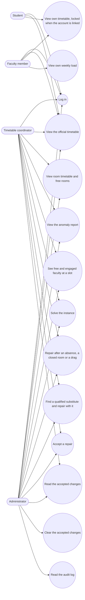

Files: `backend/app/routers.py` (`Solver` = administrator or coordinator, `Administrator`),
`frontend/src/types/roles.ts` (`ROLE_CAPABILITIES`), `frontend/src/App.tsx` (which panel each
role sees). Reading routes need only a valid token. The faculty and student lock (D50) is in the
UI only, because timetables are not secret.

## 2. Class diagrams

### 2.1 Database models

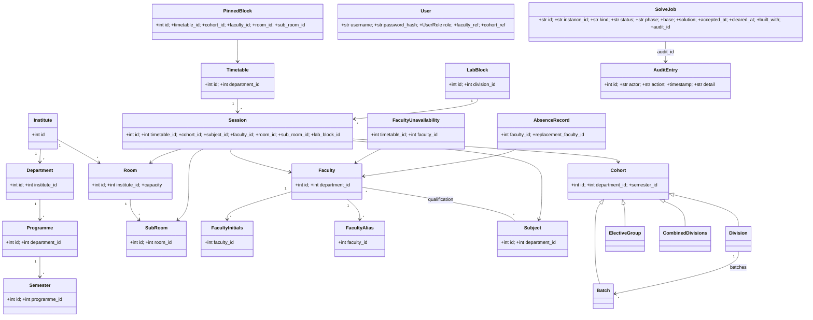

File: `db/models.py`. Every entity carries `department_id` except `Institute`, `Room` and
`SubRoom` (`docs/CONTEXT.md` rule 5). `User` is the table `app_user`.

`SolveJob` holds solve and repair jobs. An accepted repair's change is the accepted change that
later jobs include (`accepted_at`, `cleared_at`, `built_with`; migration
`0009_accepted_changes`). There is no separate table for accepted changes.

### 2.2 Solver core types

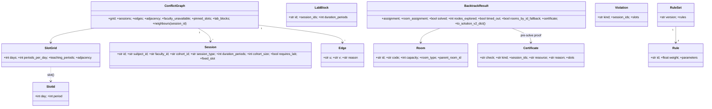

Files: `solver/slots.py` (`SlotId`, `SlotGrid`), `solver/graph.py` (`Session`, `Edge`,
`ConflictGraph`), `solver/backtracking.py` (`Room`, `LabBlock`, `BacktrackResult`),
`solver/presolve.py` (`Certificate`), `solver/validate.py` (`Violation`), `solver/scoring.py`
(`Rule`, `RuleSet`). The solver takes and returns plain data (the edge-list and `solution.v2`
contracts); these types never leave `solver/`.

## 3. Sequence diagrams

### 3.1 Login

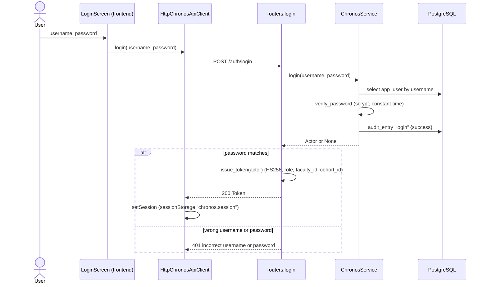

Files: `frontend/src/components/auth/LoginScreen.tsx`, `frontend/src/api/chronosApi.ts`,
`backend/app/routers.py`, `backend/app/service.py`, `backend/app/auth.py`.

### 3.2 A solve job

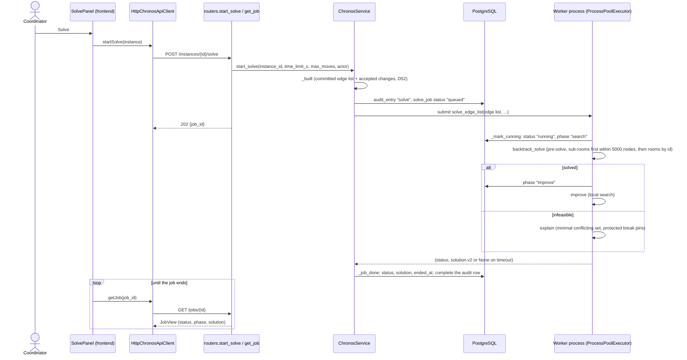

Files: `frontend/src/components/timetable/SolvePanel.tsx`, `frontend/src/api/queries.ts`
(`useSolveMutation`, `useJobQuery`), `backend/app/routers.py`, `backend/app/service.py`
(`start_solve`, `_start`, `solve_edge_list`, `_mark_running`, `_job_done`), `solver/backtracking.py`,
`solver/improve.py`, `solver/mus.py`. The search makes up to two attempts (S14x): sub-rooms first
within 5,000 nodes (`SUB_ROOM_NODES` = `RING_NODES`), then rooms by id in the time left, only if
that budget ran out with no verdict. A verdict of the first attempt stands, and running out of
time is the status `timeout`, never `infeasible` (D33).

### 3.3 An absence, repaired and accepted

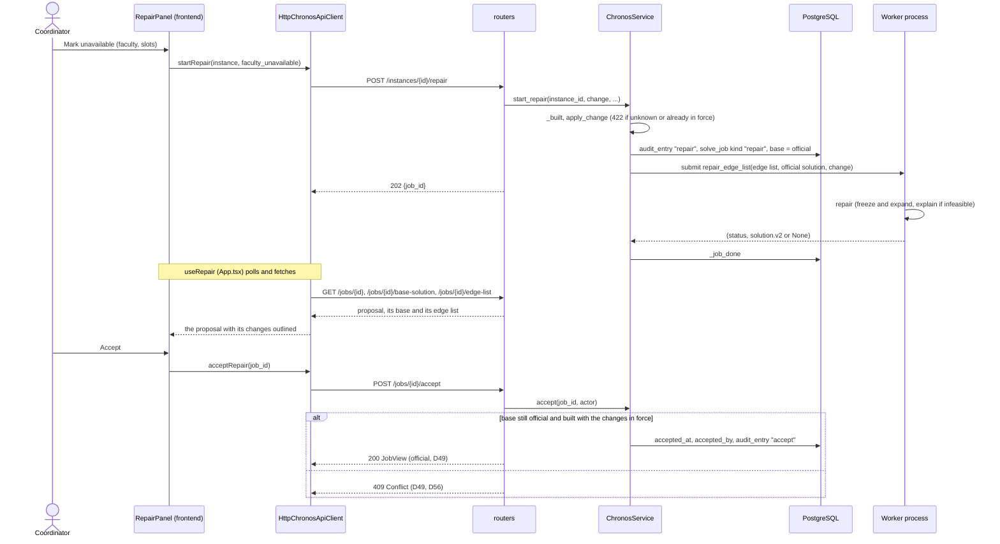

Files: `frontend/src/components/timetable/RepairPanel.tsx`, `frontend/src/api/queries.ts`
(`useRepair`), `backend/app/routers.py`, `backend/app/service.py` (`start_repair`,
`repair_edge_list`, `accept`), `solver/repair.py`.

### 3.4 A substitution (both workloads recalculated, S14m)

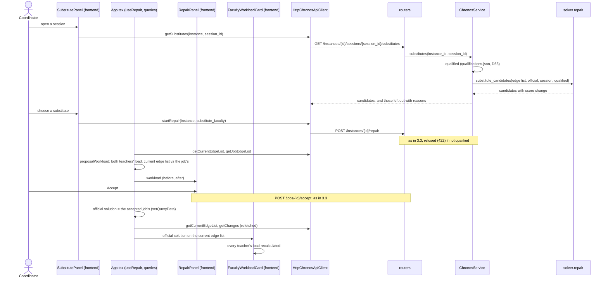

Files: `frontend/src/components/timetable/SubstitutePanel.tsx`, `RepairPanel.tsx`,
`FacultyWorkloadCard.tsx`, `frontend/src/App.tsx`, `frontend/src/api/queries.ts`
(`useSubstitutesQuery`), `backend/app/service.py` (`substitutes`, `qualified`),
`solver/repair.py` (`substitute_candidates`, `apply_change`).

### 3.5 Clearing the accepted changes (D52, D56)

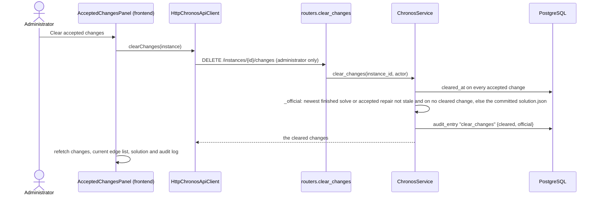

Files: `frontend/src/components/timetable/AcceptedChangesPanel.tsx`, `frontend/src/api/queries.ts`
(`useClearChangesMutation`), `backend/app/routers.py`, `backend/app/service.py`
(`clear_changes`, `_official`, `_stale`).

## 4. State diagram of a job

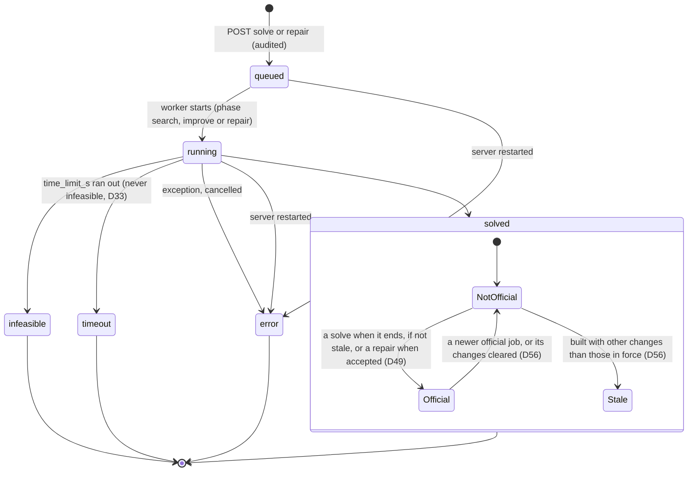

Files: `backend/app/service.py` (statuses `queued`, `running`, `solved`, `infeasible`, `timeout`,
`error`; the code says `error`, not "failed"; `_official`, `_stale`, `accept`),
`backend/app/routers.py` (`JobView`). A finished infeasible solve can also be the official
result (`_official` takes solves that are solved or infeasible). A repair is official only once
accepted, and only a solved one can be.

## 5. Activity diagram of a repair

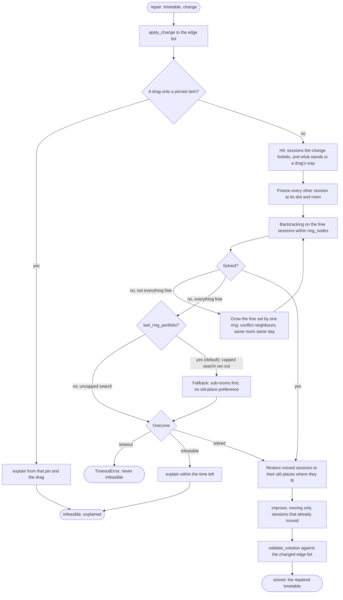

File: `solver/repair.py` (`repair`, `apply_change`, `_frozen_in_the_way`, `_in_the_way`).
Defaults: `RING_NODES = 5_000`, `MAX_MOVES = 20_000`. `prefer_sub_rooms` and
`last_ring_portfolio` are on by default since S14u (added off in S14s, D58). `time_limit_s`
covers the whole call (S14k).

## 6. Component diagram

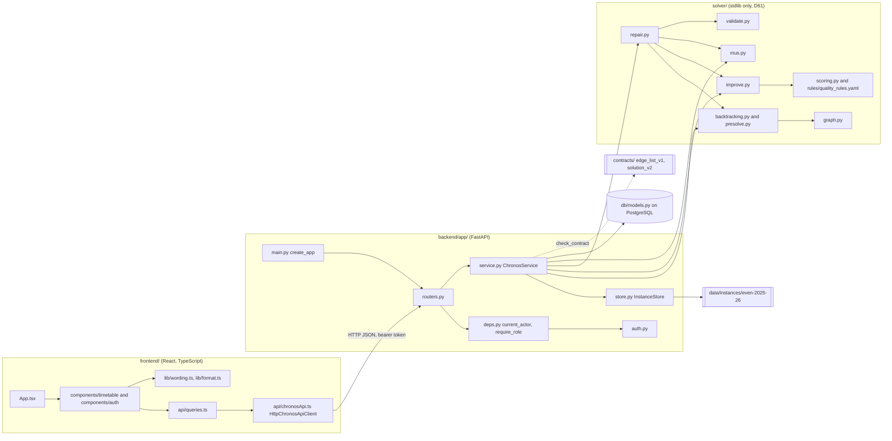

Files as named in the boxes. `backend/app/service.py` is the only backend module that calls the
solver. `solver/` imports no web, ORM or database code.

## 7. Deployment diagram (D55, D57)

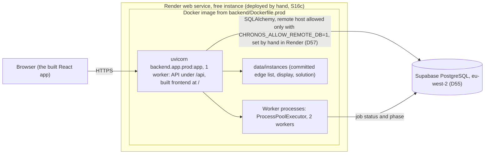

Files: `backend/Dockerfile.prod`, `backend/app/prod.py`, `backend/app/service.py`
(`max_workers=2`), `db/local_guard.py`.

- **Built and deployed** (S16c, 2026-11-01): one Render web service on the free instance, built
  from `backend/Dockerfile.prod`. It runs one uvicorn worker and a pool of 2 solver worker
  processes (`ProcessPoolExecutor`, `max_workers=2` in `ChronosService`). Its database is
  Supabase PostgreSQL in eu-west-2 (D55). Locally the same app runs against Docker Postgres.
- **By hand only:** migrations and demo resets reach Supabase only when Nidhi runs them, with
  `CHRONOS_ALLOW_REMOTE_DB=1` set for that one command (D55, D57, D59). Only the Render service
  sets that variable, in Render's settings.
- **Live demos run on a laptop** (D64): Render's free instance is about 9 times slower than a
  laptop, so the deployed site is shown, not driven.
